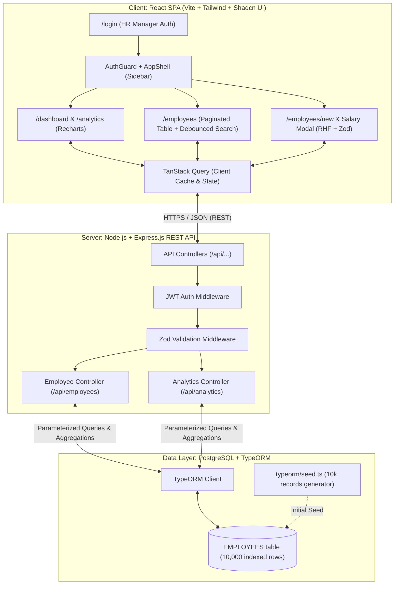

# ACME – System Architecture Diagram

## High-Level Component & Request Flow

View Diagram: [Click to view ](https://mermaid.live/edit#pako:eNqFVNtu2zgQ_ZUBHwwFvsmX2olQFPDa7sZF3NiWtsXG2oexOJW1pUmBouq4Sf59QUXKNnIWqydSM-dw5pwhH1ikODGPfRPqGO1RGwhmoQ4lAECW72KN6R6mIiFpYBuy55UHG8LIgL-agPMlMQRNCDARx0RyaIK_Rx5J-GNxEbK_KjL73ag4kduQdYVdgHO9gSVKjEnDJDf7evrvOWq-DZmNFWtowiRN_T0JAY6fcNqhroNmmO3tERyz_U5ZUAO6KFGcTBJl4GyoaDM7wyXawuiQCnUiysBZYZxINMQhwJ2wPc5op3IZEQefUEdnBX9U-vCKpCvpCA3wUaA-wVJxFOBsrj9CE-4Ur8M3623IApS-weg7rHPSJ3BK7acY7clSGTRUAc-0hXb7w7NsZzoWISsONGyv0CiqrSv3KgjvLWazrpJI8l9PfRmPyWphZ8Mn_YO0B58Vp87fGTRhfp9qyjK72cz9wCbWWrbWLr9uQ_bpa1BsYJlwLuiImmqpd4oXmXeKwxcUCUeTKPnf-ZPVYmq0sPOzWsBUSaOVEKQzcLqYJt1Op1M3YH5IS8i8dPAXXAl78bYOts5k1Ykv83aGfxnFt0wsay68epbmXKwiWIhxpk4RKpsoZ6Wo6P8MnP1m_ZuhQbjBk_VwpTITa_LXN_Zqn1K63Sxr_ZZ_7cg-r8pn4lzTYCe2Tsjmy9XN7Z_zuQ-muE9Oz225rguJ5HRPHLQ6WlEuXqtKZJ8Ac0pJ6UM3I-Idk1nsd9AUKc0ziEmSRqP0W5JWxb0vtQl2os4P7U77w-NCJiZBUfx5rGXWhNusC7rHkF0HwcqHLnzybz-DY4f8ImSPlY9V_huWVAQr1HggQzr5Sby48wll0IBJHGuKixHPLGPlQcHIWizWCWee0Tm12IH0Ae2WPdhoyMyeDhQyD0Kmief37UgJpUMWyifWYinKO6UOFVqrPN4z7xuKjFosTzkamiUYa_w3hSQnPVW5NMzrDYduQcK8B3bPvOFVvzN6N3DHo964dzl-12In5g3dTn80GvdGrjsY9sZX46cW-1kc6nYuB71hf3A16vcu-_3h1eDpH73nAYA)

## API Endpoint Contract

| Method | Endpoint | Auth | Purpose | Query / Body Params |
| :--- | :--- | :--- | :--- | :--- |
| `POST` | `/api/auth/login` | Public | Authenticate HR Manager | `{ email, password }` |
| `GET` | `/api/employees` | Protected | Paginated list + search/filter | `?page=1&limit=20&search=&country=&department=` |
| `GET` | `/api/employees/:id` | Protected | Single employee details | `id` (UUID or `employee_id`) |
| `POST` | `/api/employees` | Protected | Create new employee record | Employee JSON payload |
| `PUT` | `/api/employees/:id` | Protected | Update employee info or salary | Partial/Full Employee JSON |
| `GET` | `/api/analytics` | Protected | KPI totals + group-by charts | `?currency=USD` (optional scope) |